# ITG Career Development Platform

An AI-powered web platform that helps employees grow their skills, follow a clear career path and reach their next promotion, and gives HR one place to review, decide and measure.

Built with **ASP.NET Core MVC (.NET 10)**, **Entity Framework Core**, **SQL Server** and the **Google Gemini API**. Fully bilingual (English / Arabic with RTL), with light and dark mode and a responsive layout for phones.

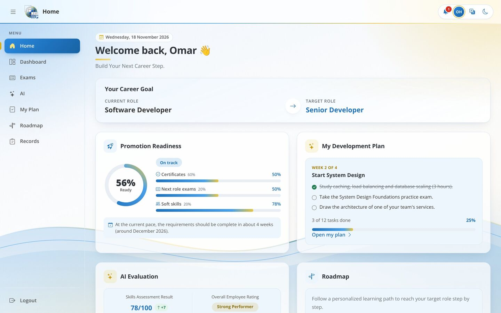

---

## Contents

- [Features](#features)
- [Screenshots](#screenshots)
- [Tech stack](#tech-stack)
- [Getting started](#getting-started)
- [Demo accounts](#demo-accounts)
- [Project structure](#project-structure)
- [Troubleshooting](#troubleshooting)

---

## Features

### For employees
| Feature | Description |
|---|---|
| **Career goal** | Current role and target role, with the required certificates for the next role. |
| **Career roadmap** | Ordered certificates per position; upload proof (PDF or image) for HR review; status for every step. |
| **AI practice exams** | Questions generated by AI for each exam; only exams linked to the employee's current or next position are shown; timer, auto-saved answers and full review. |
| **AI skills assessment** | 16 workplace situations scored across Teamwork, Problem Solving, Communication and Leadership; the last two results are compared on a radar chart. |
| **AI career assistant** | Chat that answers using the employee's own roadmap, exams and skills. |
| **AI development plan** | A personal 4-week plan with weekly tasks that can be ticked off. |
| **Promotion readiness** | One score (60% certificates, 20% next-role exams, 20% soft skills) with an estimated time to complete the requirements. |
| **Records & notifications** | Passed exams, verified certificates and skills score; a notification bell for reviews, path decisions and promotions. |

### For HR / Admin
| Feature | Description |
|---|---|
| **Admin dashboard** | Live employee table with search, department and status filters. |
| **Certificate review** | Approve or reject uploads with a reason; the employee is notified instantly. |
| **Career path decisions** | At the end of a career stage HR assigns the next path, or opens several for the employee to choose once. |
| **Promotions** | One-click promotion with full history. |
| **Analytics** | KPIs, soft skills by department vs. company, career status, exam pass rates, promotions per month, employees closest to promotion and the most needed next certificates, plus an **AI summary** with a recommendation. |
| **Learning management** | Manage certificates, exams (linked to positions), career paths, positions, departments and employees. |

---

## Screenshots

| Sign in | Career roadmap |
|---|---|
| 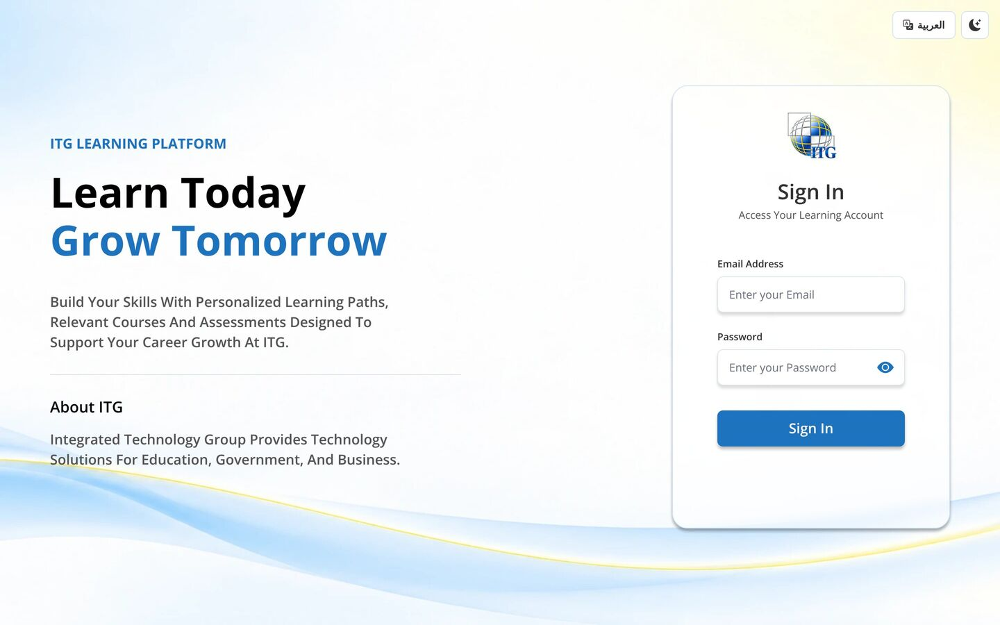 | 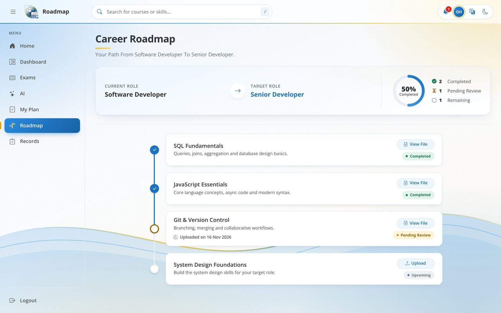 |

| AI practice exams | AI development plan |
|---|---|
| 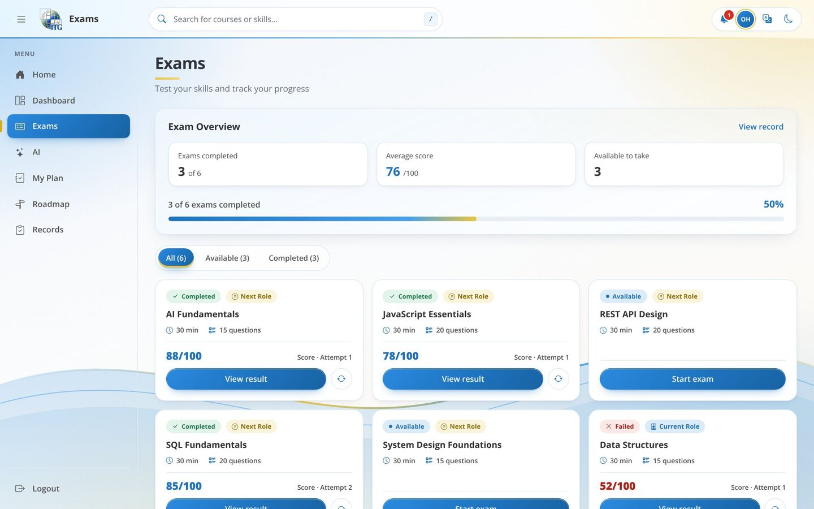 | 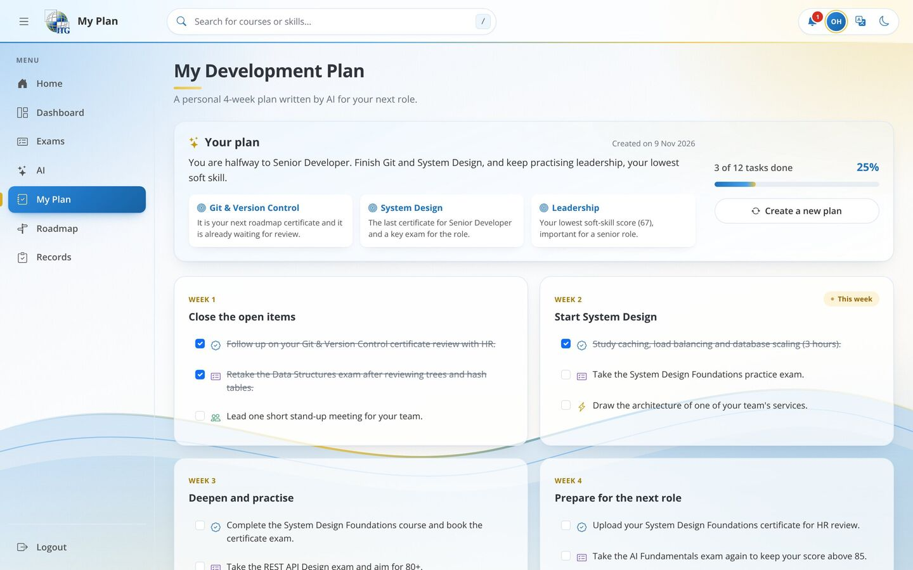 |

| AI career assistant | Admin dashboard |
|---|---|
| 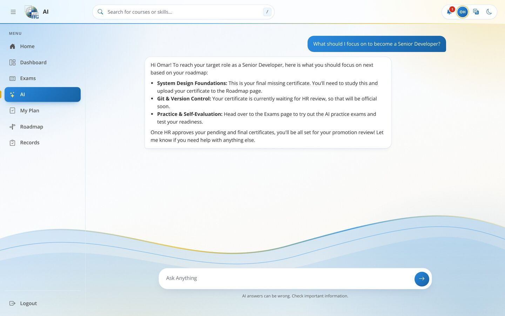 | 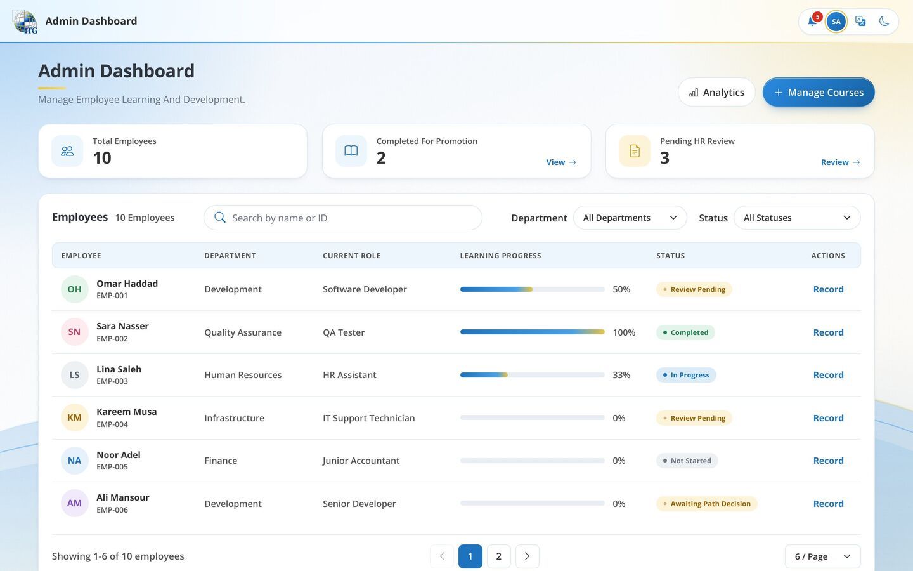 |

| Analytics with AI insights | Analytics charts |
|---|---|
| 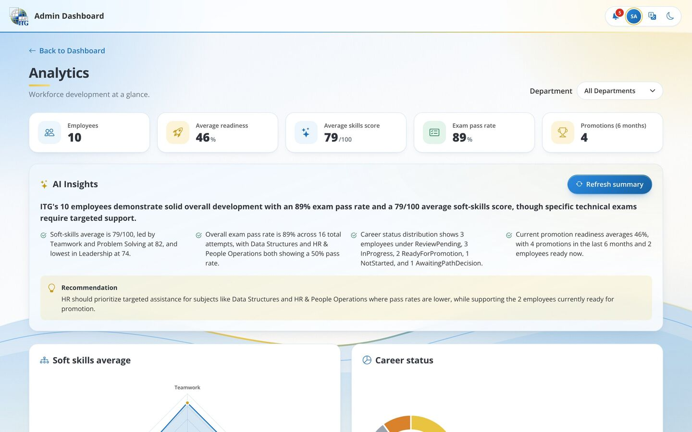 | 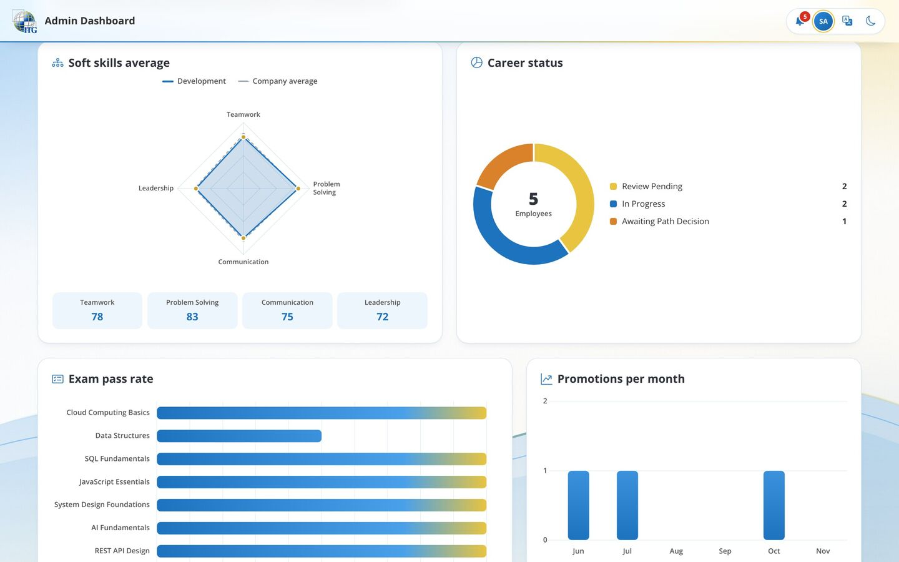 |

| Career path decision (HR) | Arabic + dark mode |
|---|---|
| 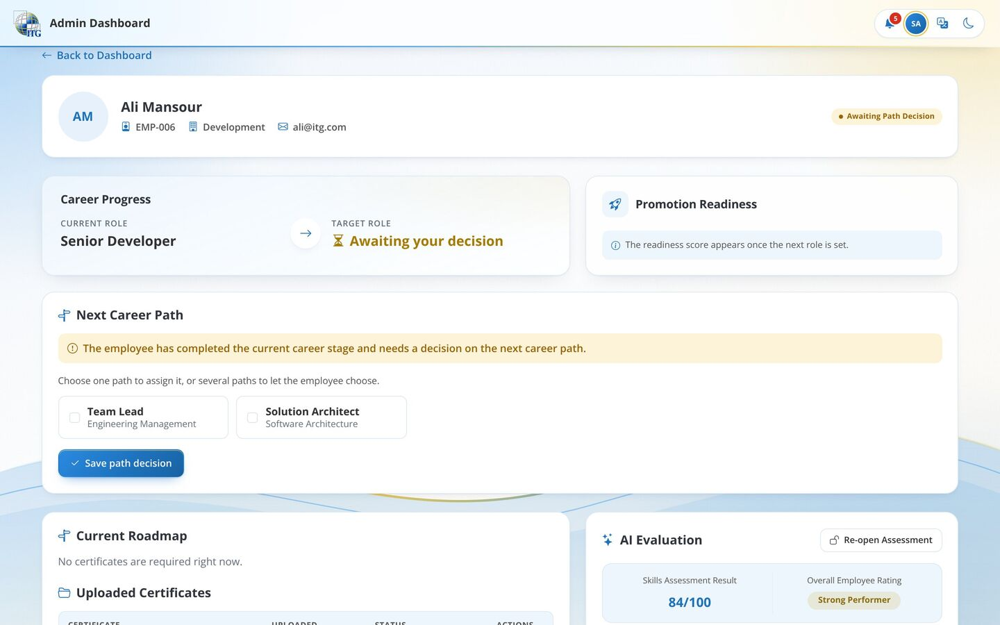 | 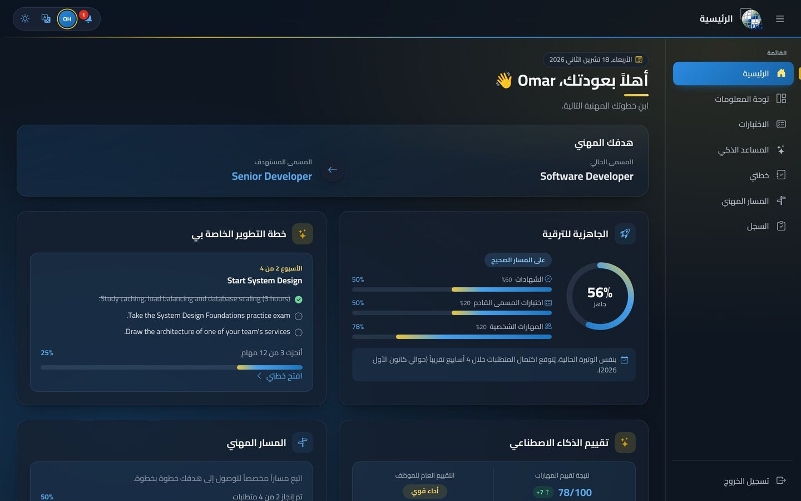 |

<p align="center">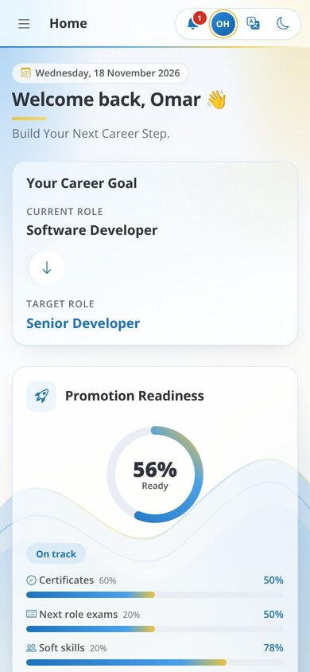</p>

---

## Tech stack

| Layer | Technology |
|---|---|
| Web | ASP.NET Core MVC (.NET 10), Razor views, Admin area |
| UI | Bootstrap 5, Bootstrap Icons, Chart.js, Tom Select |
| Data | Entity Framework Core 10 (code first), SQL Server |
| Identity | ASP.NET Core Identity with Employee and Admin roles |
| AI | Google Gemini API |
| Localization | English / Arabic resource files, full RTL support |

---

## Getting started

### 1. Requirements

- **Windows** with **Visual Studio 2022 (17.14 or newer) or Visual Studio 2026**, with the *ASP.NET and web development* workload
- **.NET 10 SDK**
- **SQL Server Express** (instance name `SQLEXPRESS`) — or any SQL Server / LocalDB (see step 3)
- A free **Google Gemini API key** for the AI features (step 4)

### 2. Get the code

```bash
git clone https://github.com/MAHMOUDADEEB/ITG.git
```

Or click **Code ▸ Download ZIP** on GitHub and extract it. Then open **`ITG.slnx`** in Visual Studio.

### 3. Database

The connection string is in `ITG/appsettings.json`:

```json
"DefaultConnection": "Server=.\\SQLEXPRESS;Database=ITGDb;Trusted_Connection=True;TrustServerCertificate=True"
```

- With **SQL Server Express**, nothing needs to change.
- With **LocalDB**, use `Server=(localdb)\\MSSQLLocalDB` instead of `Server=.\\SQLEXPRESS`.

**You don't need to create the database.** On the first run the app applies all migrations and fills the database with demo data automatically.

### 4. Gemini API key (for the AI features)

1. Create a free key at **[Google AI Studio](https://aistudio.google.com/apikey)**.
2. In Visual Studio, right-click the **ITG** project ▸ **Manage User Secrets**, and paste:

   ```json
   {
     "Gemini": {
       "ApiKey": "YOUR-API-KEY"
     }
   }
   ```

   Or from a terminal in the `ITG` project folder:

   ```bash
   dotnet user-secrets set "Gemini:ApiKey" "YOUR-API-KEY"
   ```

> The key is stored on your computer only and is never committed to the repository.
> Without a key the whole platform still works; only the AI features show a "service not available" message.

### 5. Run

Press **Ctrl + F5** in Visual Studio (or run `dotnet run --project ITG`). The site opens at:

- `http://localhost:5246`
- `https://localhost:7045` (with the *https* profile)

---

## Demo accounts

| Role | Email | Password | What to look at |
|---|---|---|---|
| Admin (HR) | `admin@itg.com` | `Admin@123` | Dashboard, reviews, analytics, path decisions, management |
| Employee | `omar@itg.com` | `Employee@123` | Readiness score, AI plan, skills comparison, exams |
| Employee | `noor@itg.com` | `Employee@123` | First skills assessment, creating an AI plan |
| Employee | `ali@itg.com` | `Employee@123` | Waiting for HR to set the next career path |
| Employee | `yousef@itg.com` | `Employee@123` | Career path assigned by HR |
| Employee | `lina@itg.com` | `Employee@123` | Rejected certificate with reason |
| Employee | `rana@itg.com` | `Employee@123` | Skills assessment re-opened by HR |

Other demo employees: `sara`, `kareem`, `ahmad`, `mona` (all `@itg.com`, password `Employee@123`).

> The admin account comes from the `SeedAdmin` section of `appsettings.json`. Change it before using the platform outside a demo.

### Reset the demo data

In Visual Studio open **Tools ▸ NuGet Package Manager ▸ Package Manager Console**, run `Drop-Database` (answer `Y`), then press **Ctrl + F5**. The database is created again with fresh demo data.

---

## Project structure

```
ITG/
├── Areas/Admin/        HR area: controllers and views (dashboard, reviews, analytics, management)
├── Controllers/        Employee pages (home, dashboard, roadmap, exams, assessment, AI, plan, records)
├── Data/               DbContext, entity configurations and demo data seeder
├── Migrations/         EF Core migrations
├── Models/             Entities and enums
├── Services/           Business logic (career, exams, readiness, plans, analytics, notifications, AI client)
├── ViewModels/         Page models
├── Views/              Razor views and shared partials
├── Resources/          English and Arabic translations
└── wwwroot/            CSS, JavaScript, images and libraries
```

---

## Troubleshooting

| Problem | Fix |
|---|---|
| Cannot connect to SQL Server | Make sure SQL Server Express is running, or change the connection string (step 3). |
| AI features say "service not available" | Check the Gemini key in User Secrets and the internet connection, then try again after a minute. |
| Old data or errors after updating the code | Run `Drop-Database` in the Package Manager Console, then Ctrl + F5. |
